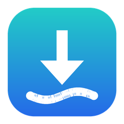

<div align="center">



# Rivulet

**Лёгкий торрент-клиент для Windows**

Один exe · нативный интерфейс · выбор файлов до начала загрузки


[Возможности](#возможности) · [Сборка из исходников](#сборка-из-исходников) · [English](#english)


&nbsp;

&nbsp;


</div>

## Возможности

- **Сначала выбор, потом загрузка.** Откройте `.torrent`, magnet-ссылку или перетащите файл в окно: Rivulet покажет список файлов, где можно отметить нужные, выбрать папку и дать загрузке своё название. Невыбранные файлы не появляются на диске даже в виде пустых заготовок.
- **Понятные карточки.** Прогресс, скорость с цветом по уровню, время до конца. По клику — подробности: сиды и пиры, отдача, размер.
- **Три режима вместо десятков настроек.** «Спокойный» бережёт компьютер и сеть, «Обычный» без ограничений скорости, «Максимум» — всё, что позволяет канал.
- **Статистика.** Сколько скачано и роздано за 7 дней, 30 дней и всё время, рейтинг раздачи, график по дням и самые раздаваемые торренты. Итоги за 30 дней видны прямо под списком.
- **Поиск и переименование.** Ctrl+F фильтрует список, F2 переименовывает загрузку.
- **Работает в фоне.** Значок в трее со скоростью, уведомления о завершении, автозапуск вместе с Windows.
- **Встраивается в Windows.** Открывает `.torrent` и magnet-ссылки (после выбора в «Приложениях по умолчанию»), всегда работает одна копия, светлая или тёмная тема — как в Windows. Своя строка заголовка с кнопками окна; окно перетаскивается, разворачивается и прилипает к краям как обычно.
- **Без лишнего.** Один `rivulet.exe` около 7 МБ, без установщика, рантаймов и WebView. Данные — в `%LOCALAPPDATA%\Rivulet`.

## Горячие клавиши

| Клавиша | Действие |
|---|---|
| Ctrl+O | Открыть .torrent-файл |
| Ctrl+V | Вставить magnet-ссылку |
| Ctrl+F | Поиск |
| F2 | Переименовать выбранную загрузку |
| Пробел | Пауза / продолжить выбранные |
| Delete | Убрать выбранные из списка |
| Ctrl+A | Выбрать все |

## Сборка из исходников

Нужны [Rust](https://rustup.rs) и Visual Studio Build Tools (C++).

```powershell
cargo build --release
```

Готовый файл — `target\release\rivulet.exe`. Ключи командной строки:

| Ключ | Что делает |
|---|---|
| `<файл.torrent>` или `<magnet:…>` | Открыть торрент (в уже запущенной копии) |
| `--minimized` | Запуститься в трее |
| `--register` / `--unregister` | Зарегистрировать или убрать Rivulet как обработчик .torrent и magnet |
| `--quit` | Корректно закрыть запущенную копию |

Для проверки движка без окна есть консольная версия `rivulet-cli`.

## Как устроено

- Движок — [librqbit](https://github.com/ikatson/rqbit) (Apache-2.0): DHT, трекеры, uTP, UPnP, восстановление сессии.
- Интерфейс — Win32, Direct2D и DirectWrite, без фреймворков.
- Невыбранные файлы торрента не создаются: куски на их границах хранятся в служебном файле `%LOCALAPPDATA%\Rivulet\parts`, который удаляется вместе с загрузкой.

BitTorrent — это протокол передачи данных. Скачивайте и раздавайте только то, на что у вас есть право.

---

## English

**Rivulet** is a light BitTorrent client for Windows: a single native exe (~7 MB, Win32 + Direct2D, engine by librqbit).

- Pick files, folder and a display name before a download starts; unselected files never appear on disk.
- Clean download cards, three performance modes, search (Ctrl+F) and rename (F2).
- Statistics: downloaded and uploaded over 7 days, 30 days and all time, share ratio, a daily chart and the most seeded torrents.
- Tray icon, notifications, start with Windows, opens `.torrent` files and magnet links, single instance, follows the Windows theme and accent color.

Build with `cargo build --release`. MIT licensed.
