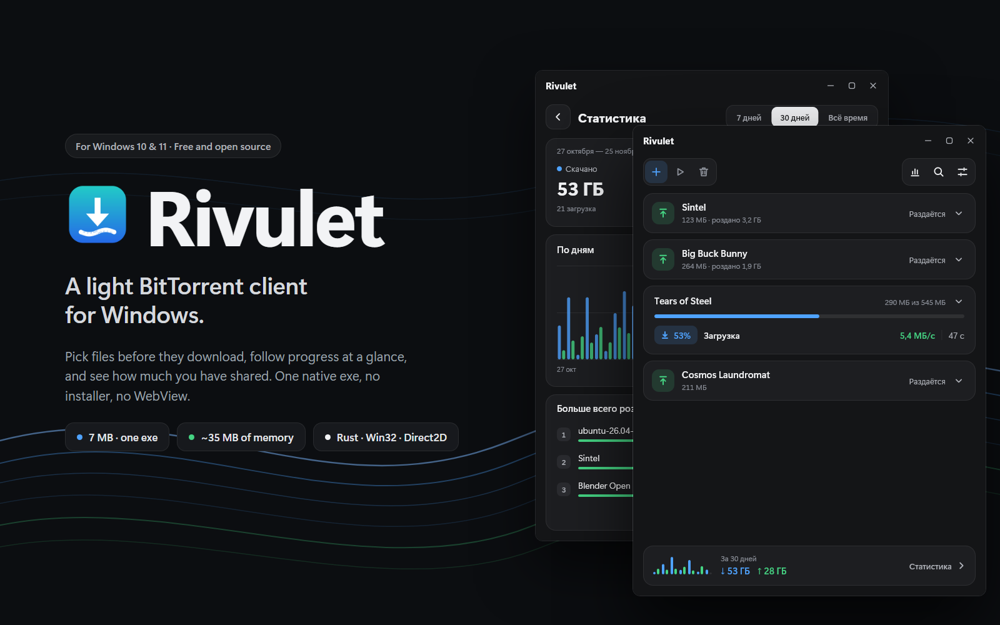
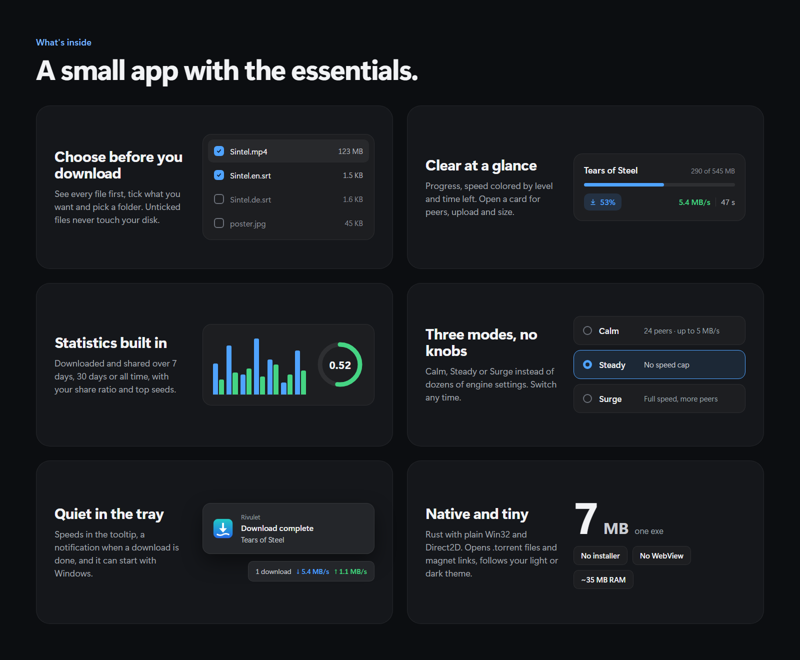
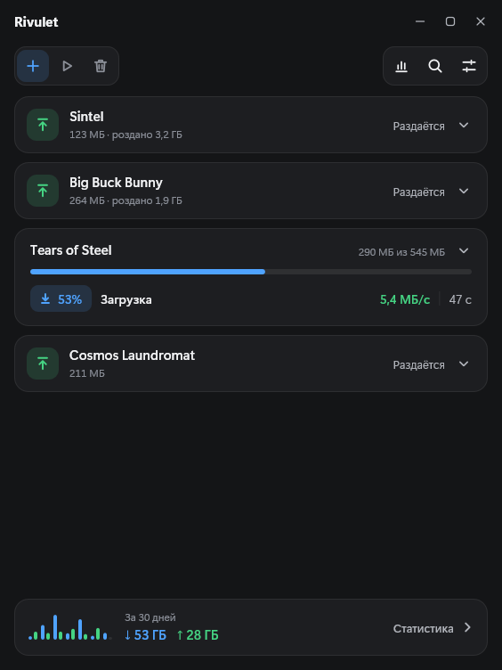
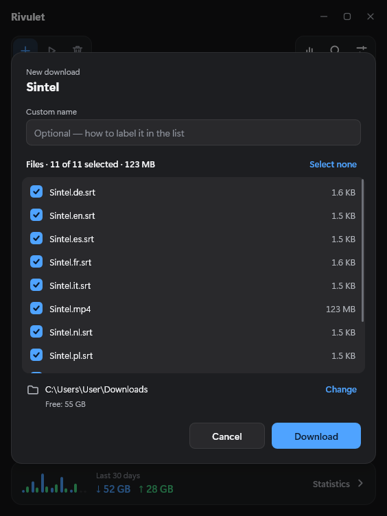
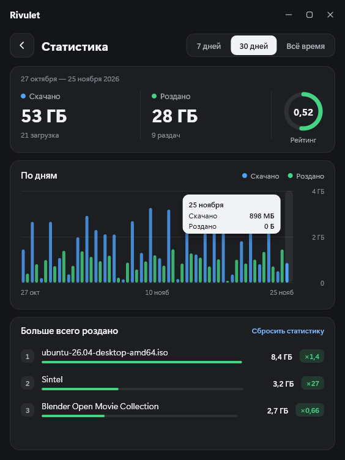

<div align="center">



[](../../actions/workflows/build.yml)


[**Download**](../../releases/latest) · [Features](#features) · [Build from source](#build-from-source) · [На русском](#на-русском)

</div>

## Features



- **Choose before you download.** Open a `.torrent` file or a magnet link, tick the files you want, pick a folder and give the download your own name. Unticked files never appear on disk, not even as empty placeholders.
- **Clear at a glance.** Progress, speed colored by level and time left; expand a card for peers, upload and size.
- **Statistics built in.** Downloaded and shared over 7 days, 30 days or all time, share ratio, a daily chart and your most seeded torrents. A 30-day summary sits right under the list.
- **Three modes, no knobs.** Calm, Steady or Surge instead of dozens of engine settings.
- **Quiet in the tray.** Speeds in the tooltip, a notification when a download is done, optional start with Windows.
- **At home on Windows.** Opens `.torrent` files and magnet links, keeps a single copy running, follows your light or dark theme, snaps and resizes like any window.
- **Native and tiny.** One `rivulet.exe` of about 7 MB, ~35 MB of memory while downloading. No installer, no runtime, no WebView.

The interface is currently in Russian.

## Screenshots

| Downloads | Choosing files | Statistics |
|---|---|---|
|  |  |  |

## Install

Download `rivulet.exe` from the [latest release](../../releases/latest), put it in any folder and run it. To open `.torrent` files and magnet links with Rivulet, use **Settings → Open .torrent and magnet in Rivulet** and pick Rivulet in Windows *Default apps*.

The exe is not code-signed, so SmartScreen may warn on first launch: *More info → Run anyway*.

## Keyboard shortcuts

| Key | Action |
|---|---|
| Ctrl+O | Open a .torrent file |
| Ctrl+V | Paste a magnet link |
| Ctrl+F | Search |
| F2 | Rename the selected download |
| Space | Pause / resume selected |
| Delete | Remove selected from the list |
| Ctrl+A | Select all |

## Command line

| Argument | What it does |
|---|---|
| `<file.torrent>` or `<magnet:…>` | Open a torrent (in the running copy, if any) |
| `--minimized` | Start in the tray |
| `--register` / `--unregister` | Register or remove Rivulet as a handler for .torrent and magnet |
| `--quit` | Close the running copy cleanly |

## Build from source

Requires [Rust](https://rustup.rs) and Visual Studio Build Tools (C++).

```powershell
cargo build --release
```

The result is `target\release\rivulet.exe`. A console front end, `rivulet-cli`, is included for testing the engine.

## How it works

- Engine: [librqbit](https://github.com/ikatson/rqbit) (Apache-2.0) — DHT, trackers, uTP, UPnP, session restore.
- UI: plain Win32, Direct2D and DirectWrite, drawn by hand; no UI framework.
- Unselected files are never created: pieces on their edges go to a sparse `.parts` file in `%LOCALAPPDATA%\Rivulet\parts`, removed together with the download.
- Settings, session and statistics live in `%LOCALAPPDATA%\Rivulet`. No telemetry.

BitTorrent is a way to move data. Download and share only what you have the right to.

## License

[MIT](LICENSE)

---

## На русском

**Rivulet** — лёгкий торрент-клиент для Windows: один нативный exe около 7 МБ (Rust, Win32, Direct2D, движок librqbit). Перед загрузкой можно выбрать файлы, папку и своё название, а невыбранные файлы не появляются на диске. Есть статистика скачанного и розданного, три режима работы, поиск и переименование, значок в трее, уведомления и автозапуск. Rivulet открывает `.torrent` и magnet-ссылки. Интерфейс на русском. [Скачать](../../releases/latest).
